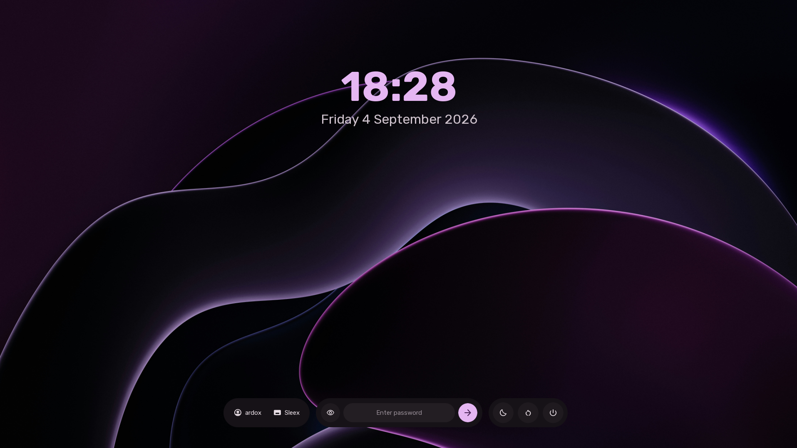

# axos sddm-theme

Minimal SDDM theme for Axos.



### Installation (on AxOS)

```bash
epsi i sddm-theme-axos
```

### Installation (on other distros)

Warning: This theme is designed for AxOS, and may not work properly on other distributions. You will need to install Sleex UI Kit manually.

```bash
git clone https://github.com/axos-project/sddm-theme.git
cd sddm-theme
makepkg -si
```